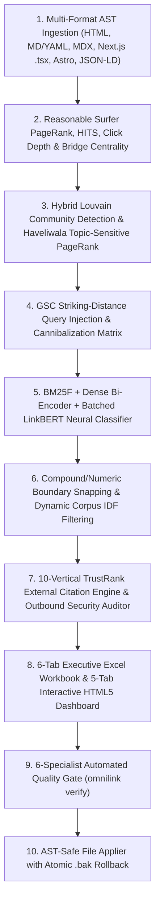

# OmniLink SEO v2 (LinkBERT Pro Engine)

[](https://opensource.org/licenses/MIT)
[](https://www.python.org/)
[](https://github.com/muyiwaadekojede/OmniLink-SEO-v2)
[](https://huggingface.co/dejanseo/LinkBERT)
[](https://github.com/muyiwaadekojede/OmniLink-SEO-v2)
[](https://github.com/muyiwaadekojede/OmniLink-SEO-v2)

**OmniLink SEO v2** is an open-source, all-in-one SEO **Internal & External Link Optimization Engine**, **Web Graph Simulator**, **Search Console Striking-Distance Optimizer**, and **E-E-A-T Citation Intelligence Framework**.

Rather than relying on a single algorithm, OmniLink SEO v2 combines **10+ peer-reviewed algorithms** across Graph Theory, Information Retrieval, Computational Linguistics, and Search Engine Patent Engineering:
* **Graph Theory & Link Equity**: Reasonable Surfer PageRank (US Patent 7,716,225 B1), Kleinberg HITS (Hubs & Authorities), Haveliwala Topic-Sensitive PageRank, Brandes Shortest-Path Betweenness Centrality, Louvain Community Modularity, and BFS Click Depth.
* **Information Retrieval & Neural NLP**: BM25F Field-Weighted Probabilistic Search, Dense Bi-Encoder Vector Similarity (`all-MiniLM-L6-v2`), Cross-Encoder Joint-Attention Re-Ranking (`ms-marco-MiniLM`), Calibrated `LinkBERT` Neural Token Classification, and Shannon Entropy Anchor Diversity Guards.
* **External Linking & E-E-A-T Citations**: 10-Vertical TrustRank Seed Authority Ontology (60+ primary repositories including W3Techs, HTTP Archive, StatCounter, Statista, W3C, RFCs, OWASP, NIST, PubMed, AVMA, SEC, Baymard), Outbound Link Budgeting, and Existing Link Security/Protocol Auditing.
* **Google Search Console (GSC) Full-Loop Integration**: Striking-Distance Query Injection (Positions 4–20) and Keyword Cannibalization Detection & Consolidation.
* **AST-Safe Codebase Automation**: Atomic `.bak` backup & rollback link injection across HTML, Markdown, MDX, Next.js (`.tsx`/`.jsx`), and Astro (`.astro`).

---

## 1. Origins, Credit & Community Attribution

### The Neural Token Classification Foundation: Dan Petrovic & DEJAN Marketing
The neural token-classification layer of OmniLink SEO v2 builds upon the pioneering research and model weights created by Australian SEO innovator **Dan Petrovic** ([DEJAN Marketing](https://dejanmarketing.com), [GitHub: @dejanmarketing](https://github.com/dejanmarketing), [Dejan AI](https://dejan.ai)):
* **Hugging Face Model Hub**: [`dejanseo/LinkBERT`](https://huggingface.co/dejanseo/LinkBERT)
* **Original GitHub Repository**: [`dejanmarketing/linkBERT`](https://github.com/dejanmarketing/linkBERT)
* **Research & Concept**: [LinkBERT by Dan Petrovic](https://dejanmarketing.com/linkbert/)

Dan Petrovic introduced the breakthrough concept of treating natural anchor text placement as a sequence labeling / binary token-classification problem ($P(\text{link} \mid \text{token})$) fine-tuned on editorial web corpora.

### How OmniLink SEO v2 Expands This Into a Complete Multi-Algorithm Ecosystem
While `LinkBERT` serves as one of our candidate span detectors, **OmniLink SEO v2** expands the scope from single-passage token prediction into a complete site-wide **Internal + External + Graph + GSC + AST** architecture:

```
┌──────────────────────────────────────────────────────────────────────────────┐
│                         OmniLink SEO v2 Architecture                         │
├──────────────────────────────────┬───────────────────────────────────────────┤
│ Neural Span Component (Petrovic) │ All-In-One System (OmniLink SEO v2.0)     │
├──────────────────────────────────┼───────────────────────────────────────────┤
│ • Raw token-level link binary    │ • Batched sliding-window inference with   │
│   probability prediction         │   compound & numeric boundary snapping    │
│ • Single text passage evaluation │ • Multi-format AST ingestion: HTML, MD,   │
│ • Independent anchor guessing    │   MDX, YAML frontmatter, Next.js (.tsx),  │
│                                  │   Astro (.astro) & Schema.org JSON-LD     │
│                                  │ • Reasonable Surfer PageRank, Kleinberg   │
│                                  │   HITS, Click Depth & Bridge Centrality   │
│                                  │ • Topic-Sensitive PageRank (Haveliwala)   │
│                                  │   & Hybrid Semantic-Graph Louvain Silos   │
│                                  │ • BM25F Field-Weighted Retrieval + Dense  │
│                                  │   Bi-Encoder + Cross-Encoder Re-Ranking   │
│                                  │ • Unsupervised Corpus IDF Filtering &     │
│                                  │   Dynamic Canonical Entity Auto-Locking   │
│                                  │ • GSC Striking-Distance Query Injection & │
│                                  │   Cannibalization Consolidation Matrix    │
│                                  │ • 10-Vertical E-E-A-T Citation Engine     │
│                                  │   & Outbound Security / Protocol Auditor  │
│                                  │ • 5-Tab Interactive HTML5 App, 6-Tab      │
│                                  │   Excel Workbook & 6-Specialist Gate      │
└──────────────────────────────────┴───────────────────────────────────────────┘
```

---

## 2. Scientific & Theoretical Foundations

OmniLink SEO v2 is grounded in 11 peer-reviewed computer science papers, information theory formulas, and search engine patents:

### 1. Pretraining Language Models with Document Links
* **Reference**: Yasunaga, M., Leskovec, J., & Liang, P. (2022). *LinkBERT: Pretraining Language Models with Document Links*. **ACL 2022**, pp. 8003–8016. [arXiv:2203.15827](https://arxiv.org/abs/2203.15827).

### 2. Markov Chain PageRank & Reasonable Surfer Weighting
* **References**:
  * Page, L., Brin, S., Motwani, R., & Winograd, T. (1999). *The PageRank Citation Ranking: Bringing Order to the Web*. Technical Report 1999-66, Stanford InfoLab.
  * Dean, J., Ghemawat, S., et al. (2010). *Ranking Documents Based on User Behavior and Link Analysis (Reasonable Surfer Patent)*. **US Patent 7,716,225 B1**, assigned to Google LLC.
* **Mathematical Formulation**:
  $$PR(u) = \frac{1 - d}{N} + d \sum_{v \in B_u} PR(v) \cdot \frac{w(v \to u)}{\sum_{z \in F_v} w(v \to z)}$$
  where contextual body links receive position-decayed weights $w \in [0.75, 1.0]$ and boilerplate navigation/footer links receive $w = 0.25$.

### 3. Topic-Sensitive PageRank
* **Reference**: Haveliwala, T. H. (2002). *Topic-Sensitive PageRank*. **Proceedings of the 11th International World Wide Web Conference (WWW 2002)**, pp. 517–526.
* **Mathematical Formulation**:
  $$\mathbf{r}_{C_k} = d \mathbf{M} \mathbf{r}_{C_k} + (1 - d) \mathbf{v}_{C_k}, \quad v_{C_k, i} = \begin{cases} \frac{1}{|C_k|} & \text{if } i \in C_k \\ 0 & \text{otherwise} \end{cases}$$

### 4. Kleinberg HITS (Hubs & Authorities)
* **Reference**: Kleinberg, J. M. (1999). *Authoritative Sources in a Hyperlinked Environment*. **Journal of the ACM (JACM)**, 46(5), 604–632.
* **Mathematical Formulation**:
  $$\mathbf{a}^{(t+1)} = \frac{\mathbf{A}^T \mathbf{h}^{(t)}}{\|\mathbf{A}^T \mathbf{h}^{(t)}\|_2}, \quad \mathbf{h}^{(t+1)} = \frac{\mathbf{A} \mathbf{a}^{(t+1)}}{\|\mathbf{A} \mathbf{a}^{(t+1)}\|_2}$$

### 5. BM25F Field-Weighted Probabilistic Information Retrieval
* **Reference**: Robertson, S., & Zaragoza, H. (2009). *The Probabilistic Relevance Framework: BM25 and Beyond*. **Foundations and Trends in Information Retrieval**, 3(4), 333–389.
* **Mathematical Formulation**:
  $$\text{BM25F}(q, d) = \sum_{t \in q} \ln\left(1 + \frac{N - df(t) + 0.5}{df(t) + 0.5}\right) \cdot \frac{\tilde{f}(t, d) \cdot (k_1 + 1)}{\tilde{f}(t, d) + k_1 \left(1 - b + b \frac{|d|}{\text{avgdl}}\right)}$$
  where $\tilde{f}(t, d) = \sum_{z \in \{\text{title}, \text{h1}, \text{slug}, \text{h2}, \text{body}\}} w_z \cdot tf(t, d_z)$ with $w_{\text{title}}=3.0, w_{\text{h1}}=2.5, w_{\text{slug}}=2.0, w_{\text{h2}}=1.5, w_{\text{body}}=1.0$.

### 6. Brandes Shortest-Path Betweenness Centrality
* **Reference**: Brandes, U. (2001). *A Faster Algorithm for Betweenness Centrality*. **Journal of Mathematical Sociology**, 25(2), 163–177.

### 7. Graph Modularity & Topical Silo Cohesion
* **Reference**: Blondel, V. D., Guillaume, J.-L., Lambiotte, R., & Lefebvre, E. (2008). *Fast unfolding of communities in large networks*. **Journal of Statistical Mechanics: Theory and Experiment**, 2008(10), P10008.

### 8. Anchor Text Diversity via Shannon Entropy
* **Reference**: Shannon, C. E. (1948). *A Mathematical Theory of Communication*. **Bell System Technical Journal**, 27(3), 379–423.
* **Mathematical Formulation**:
  $$H(X) = - \sum_{i=1}^n P(x_i) \log_2 P(x_i)$$

### 9. TrustRank & Multi-Vertical E-E-A-T Seed Proximity
* **References**:
  * Gyöngyi, Z., Garcia-Molina, H., & Pedersen, J. (2004). *Combating Web Spam with TrustRank*. **Proceedings of the 30th VLDB Conference**, pp. 576–587.
  * Google LLC. (2022–2026). *Search Quality Rater Guidelines: Experience, Expertise, Authoritativeness, and Trustworthiness (E-E-A-T)*.

---

## 3. Core Architecture & Pipeline



---

## 4. Installation

```bash
# Clone the repository
git clone https://github.com/muyiwaadekojede/OmniLink-SEO-v2.git
cd OmniLink-SEO-v2

# Create a virtual environment
python -m venv .venv
source .venv/bin/activate  # On Windows: .venv\Scripts\activate

# Install dependencies and CLI (registers both `omnilink` and `linkbert` commands)
pip install -e .
```

Verify your installation:
```bash
omnilink doctor
```

---

## 5. CLI Usage & Workflows

*(Note: Both `omnilink` and `linkbert` CLI commands are registered and interchangeable.)*

### 1. Scan and Index a Website or Local Codebase
```bash
omnilink scan https://example.com --max-pages 500 --index .my_index
# Or scan a local Next.js / Astro / Markdown / HTML codebase:
omnilink scan ./my-nextjs-app --index .my_index
```

### 2. Graph Topology, PageRank, Click Depth & HITS Audit
```bash
omnilink graph --index .my_index
```

### 3. Topic Clusters & Topic-Sensitive PageRank
```bash
omnilink clusters --index .my_index --method hybrid
```

### 4. Generate Internal & External Link Recommendations with GSC Intelligence
```bash
omnilink suggest --index .my_index --gsc search_console_performance.csv --min-score 0.35 --rerank
```

### 5. Run the 6-Specialist Automated Quality Gate
```bash
omnilink verify --index .my_index
```

### 6. AST-Safe File Placement & Rollback
```bash
omnilink apply --index .my_index --dry-run --diff
omnilink apply --index .my_index --min-score 0.45
omnilink rollback --index .my_index
omnilink commit --index .my_index
```

---

## 6. Deliverables: 6-Tab Master Excel Workbook & 5-Tab HTML5 App

OmniLink SEO v2 exports a complete strategic link architecture workbook (`link_architecture_master.xlsx`):

| Tab | Sheet Name | Contents |
|---|---|---|
| **Tab 1** | `Internal_Linking_Matrix` | Source Page, Clean Anchor Text, Target Page, Target Title, Score, Engine, Exact Sentence Context, Source File, Projected PR, HTML & Markdown Snippets. |
| **Tab 2** | `External_Authority_Citations` | Source Page, Claim/Entity Anchor, Exact Sentence Context, Primary Authority URL, Title, Domain, Trust Tier (1–4), Category, Rel Attribute, Confidence, E-E-A-T Justification, Academic/Patent Basis. |
| **Tab 3** | `GSC_Striking_Distance` | Search Query, Target URL, Impressions, Clicks, CTR, Average Position, Striking Distance Tier (`Defend`, `Page 1`, `Page 2`, `Longtail`), Recommended Internal Anchor. |
| **Tab 4** | `Graph_Topology_Audit` | Page URL, Title, Current PR, Projected PR, PR Delta %, Orphan Status, Under-Linked Status, Topic Cluster, Click Depth (Hops), Projected Click Depth, HITS Authority, HITS Hub, Bridge Centrality. |
| **Tab 5** | `Anchor_Entropy_&_Silos` | Target Page, Title, Total Inbound Anchors, Unique Variations, Shannon Entropy (Bits), Exact-Match Ratio, Penguin Safety Status, Suggested Anchor Variations. |
| **Tab 6** | `Executive_Audit_Summary` | High-level KPI scorecard, Orphan Rescue delta, and Specialist Quality Gate status. |

---

## 7. Academic Citations (BibTeX)

```bibtex
@software{adekojede2026omnilinkseo,
  author       = {Adekojede, Muyiwa and Petrovic, Dan},
  title        = {OmniLink SEO v2: Enterprise-Grade Internal and External Link Optimization, Graph Simulation, and Citation Intelligence Engine},
  version      = {2.0.0},
  year         = {2026},
  publisher    = {GitHub},
  journal      = {GitHub repository},
  howpublished = {\url{https://github.com/muyiwaadekojede/OmniLink-SEO-v2}}
}

@misc{petrovic2022linkbert,
  author       = {Petrovic, Dan},
  title        = {LinkBERT: Natural Hyperlink Anchor Prediction with Fine-Tuned Language Models},
  year         = {2022},
  publisher    = {Hugging Face},
  howpublished = {\url{https://huggingface.co/dejanseo/LinkBERT}}
}

@inproceedings{yasunaga2022linkbert,
  title        = {LinkBERT: Pretraining Language Models with Document Links},
  author       = {Yasunaga, Michihiro and Leskovec, Jure and Liang, Percy},
  booktitle    = {Proceedings of the 60th Annual Meeting of the Association for Computational Linguistics (ACL 2022)},
  pages        = {8003--8016},
  year         = {2022},
  url          = {https://arxiv.org/abs/2203.15827}
}

@techreport{page1999pagerank,
  title        = {The PageRank Citation Ranking: Bringing Order to the Web},
  author       = {Page, Lawrence and Brin, Sergey and Motwani, Rajeev and Winograd, Terry},
  institution  = {Stanford InfoLab},
  year         = {1999},
  number       = {1999-66}
}

@patent{dean2010reasonable,
  title        = {Ranking Documents Based on User Behavior and Link Analysis},
  author       = {Dean, Jeffrey and Ghemawat, Sanjay and others},
  number       = {US 7,716,225 B1},
  year         = {2010},
  assignee     = {Google LLC}
}

@inproceedings{haveliwala2002topic,
  title        = {Topic-Sensitive PageRank},
  author       = {Haveliwala, Taher H},
  booktitle    = {Proceedings of the 11th International Conference on World Wide Web (WWW 2002)},
  pages        = {517--526},
  year         = {2002}
}

@article{kleinberg1999authoritative,
  title        = {Authoritative Sources in a Hyperlinked Environment},
  author       = {Kleinberg, Jon M},
  journal      = {Journal of the ACM (JACM)},
  volume       = {46},
  number       = {5},
  pages        = {604--632},
  year         = {1999}
}

@article{robertson2009probabilistic,
  title        = {The Probabilistic Relevance Framework: BM25 and Beyond},
  author       = {Robertson, Stephen and Zaragoza, Hugo},
  journal      = {Foundations and Trends in Information Retrieval},
  volume       = {3},
  number       = {4},
  pages        = {333--389},
  year         = {2009}
}

@article{brandes2001faster,
  title        = {A Faster Algorithm for Betweenness Centrality},
  author       = {Brandes, Ulrik},
  journal      = {Journal of Mathematical Sociology},
  volume       = {25},
  number       = {2},
  pages        = {163--177},
  year         = {2001}
}

@inproceedings{gyongyi2004combating,
  title        = {Combating Web Spam with TrustRank},
  author       = {Gy{\"o}ngyi, Zolt{\'a}n and Garcia-Molina, Hector and Pedersen, Jan},
  booktitle    = {Proceedings of the 30th International Conference on Very Large Data Bases (VLDB)},
  pages        = {576--587},
  year         = {2004}
}

@article{blondel2008louvain,
  title        = {Fast unfolding of communities in large networks},
  author       = {Blondel, Vincent D and Guillaume, Jean-Loup and Lambiotte, Renaud and Lefebvre, Etienne},
  journal      = {Journal of Statistical Mechanics: Theory and Experiment},
  volume       = {2008},
  number       = {10},
  pages        = {P10008},
  year         = {2008}
}

@article{shannon1948entropy,
  title        = {A Mathematical Theory of Communication},
  author       = {Shannon, Claude E},
  journal      = {Bell System Technical Journal},
  volume       = {27},
  number       = {3},
  pages        = {379--423},
  year         = {1948}
}
```

---

## 8. License

Distributed under the **MIT License**. See [`LICENSE`](LICENSE) for full details.

*Copyright (c) 2026 Muyiwa Adekojede. Neural LinkBERT Component Copyright (c) Dan Petrovic (DEJAN Marketing).*
