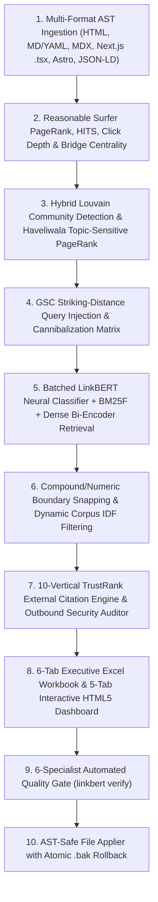

# LinkBERT Pro

[](https://opensource.org/licenses/MIT)
[](https://www.python.org/)
[](https://github.com/muyiwaadekojede/LinkBERT-Pro)
[](https://huggingface.co/dejanseo/LinkBERT)
[](https://github.com/muyiwaadekojede/LinkBERT-Pro)
[](https://github.com/muyiwaadekojede/LinkBERT-Pro)

**LinkBERT Pro (v2.0)** is an open-source, enterprise-grade SEO internal and external link optimization engine, web graph simulator, and citation intelligence framework.

It unites computational linguistics (batched neural token classification, BM25F field-weighted probabilistic retrieval, dense bi-encoder vector embeddings, cross-encoder joint-attention re-ranking) with rigorous network graph mathematics (Reasonable Surfer PageRank, Kleinberg HITS Hubs & Authorities, Haveliwala Topic-Sensitive PageRank, Brandes Betweenness Centrality, Louvain community modularity, Shannon entropy) and empirical search engine patent principles (TrustRank seed proximity, E-E-A-T primary source verification, and Google Search Console striking-distance intelligence).

---

## 1. Origins, Credit & Community Attribution

### The Original Foundation: Dan Petrovic & DEJAN Marketing
This project builds directly upon the pioneering conceptual and machine learning foundations laid by Australian SEO researcher and innovator **Dan Petrovic** ([DEJAN Marketing](https://dejanmarketing.com), [GitHub: @dejanmarketing](https://github.com/dejanmarketing), [Dejan AI](https://dejan.ai)).

#### What Was the Original Work?
Dan Petrovic introduced the breakthrough concept that hyperlink placement should not be treated as simplistic keyword matching, but as a sequence labeling / token-classification problem. He trained and released the original **`dejanseo/LinkBERT`** and **`dejanseo/LinkBERT-XL`** model weights on Hugging Face:
* **Hugging Face Model Hub**: [`dejanseo/LinkBERT`](https://huggingface.co/dejanseo/LinkBERT)
* **Original GitHub Repository**: [`dejanmarketing/linkBERT`](https://github.com/dejanmarketing/linkBERT)
* **Research & Concept**: [LinkBERT by Dan Petrovic](https://dejanmarketing.com/linkbert/)

In his original open-source scripts, Dan fine-tuned BERT (`bert-large-cased`) on editorial web corpora as a binary token classifier ($P(\text{link} \mid \text{token})$), identifying human-like, contextual anchor phrases inside unstructured text blocks.

### The Evolution: LinkBERT Pro v2.0
To provide the global search engineering and NLP community with a complete, industry-agnostic, site-wide optimization architecture, **LinkBERT Pro** extends Dan Petrovic's foundational model into a multi-tier link intelligence platform:

```
┌──────────────────────────────────────────────────────────────────────────────┐
│                           LinkBERT Pro v2.0 Ecosystem                        │
├──────────────────────────────────┬───────────────────────────────────────────┤
│ Foundational Component (Dan)     │ Enterprise Extension (LinkBERT Pro v2.0)  │
├──────────────────────────────────┼───────────────────────────────────────────┤
│ • Raw token-level link binary    │ • Batched sliding-window inference with   │
│   probability prediction         │   compound & numeric boundary snapping    │
│ • Single text passage evaluation │ • Multi-format AST ingestion: HTML, MD,   │
│ • Independent anchor guessing    │   MDX, YAML frontmatter, Next.js (.tsx),  │
│                                  │   Astro (.astro) & Schema.org JSON-LD     │
│                                  │ • Reasonable Surfer PageRank, Kleinberg   │
│                                  │   HITS, Click Depth & Bridge Centrality   │
│                                  │ • Topic-Sensitive PageRank (Haveliwala)   │
│                                  │   & Hybrid Semantic-Graph Louvain Silos   │
│                                  │ • BM25F Field-Weighted Retrieval + Dense  │
│                                  │   Bi-Encoder + Cross-Encoder Re-Ranking   │
│                                  │ • Unsupervised Corpus IDF Filtering &     │
│                                  │   Dynamic Canonical Entity Auto-Locking   │
│                                  │ • GSC Striking-Distance Query Injection & │
│                                  │   Cannibalization Consolidation Matrix    │
│                                  │ • 10-Vertical E-E-A-T Citation Engine     │
│                                  │   & Outbound Security / Protocol Auditor  │
│                                  │ • 5-Tab Interactive HTML5 App, 6-Tab      │
│                                  │   Excel Workbook & 6-Specialist Gate      │
└──────────────────────────────────┴───────────────────────────────────────────┘
```

---

## 2. Scientific & Theoretical Foundations

LinkBERT Pro is grounded in 11 peer-reviewed computer science papers, information theory formulas, and search engine patents:

### 1. Pretraining Language Models with Document Links
* **Reference**: Yasunaga, M., Leskovec, J., & Liang, P. (2022). *LinkBERT: Pretraining Language Models with Document Links*. **ACL 2022**, pp. 8003–8016. [arXiv:2203.15827](https://arxiv.org/abs/2203.15827).
* **Application**: Treats hyperlinks as first-class semantic relationships between document pairs, capturing multi-hop contextual relevance across web documents.

### 2. Markov Chain PageRank & Reasonable Surfer Weighting
* **References**:
  * Page, L., Brin, S., Motwani, R., & Winograd, T. (1999). *The PageRank Citation Ranking: Bringing Order to the Web*. Technical Report 1999-66, Stanford InfoLab.
  * Dean, J., Ghemawat, S., et al. (2010). *Ranking Documents Based on User Behavior and Link Analysis (Reasonable Surfer Patent)*. **US Patent 7,716,225 B1**, assigned to Google LLC.
* **Mathematical Formulation**:
  $$PR(u) = \frac{1 - d}{N} + d \sum_{v \in B_u} PR(v) \cdot \frac{w(v \to u)}{\sum_{z \in F_v} w(v \to z)}$$
  where contextual body links receive position-decayed weights $w \in [0.75, 1.0]$ and boilerplate navigation/footer links receive $w = 0.25$.

### 3. Topic-Sensitive PageRank
* **Reference**: Haveliwala, T. H. (2002). *Topic-Sensitive PageRank*. **Proceedings of the 11th International World Wide Web Conference (WWW 2002)**, pp. 517–526.
* **Mathematical Formulation**:
  $$\mathbf{r}_{C_k} = d \mathbf{M} \mathbf{r}_{C_k} + (1 - d) \mathbf{v}_{C_k}, \quad v_{C_k, i} = \begin{cases} \frac{1}{|C_k|} & \text{if } i \in C_k \\ 0 & \text{otherwise} \end{cases}$$
* **Application**: Computes cluster-specific topical authority scores for every page within each detected thematic silo.

### 4. Kleinberg HITS (Hubs & Authorities)
* **Reference**: Kleinberg, J. M. (1999). *Authoritative Sources in a Hyperlinked Environment*. **Journal of the ACM (JACM)**, 46(5), 604–632.
* **Mathematical Formulation**:
  $$\mathbf{a}^{(t+1)} = \frac{\mathbf{A}^T \mathbf{h}^{(t)}}{\|\mathbf{A}^T \mathbf{h}^{(t)}\|_2}, \quad \mathbf{h}^{(t+1)} = \frac{\mathbf{A} \mathbf{a}^{(t+1)}}{\|\mathbf{A} \mathbf{a}^{(t+1)}\|_2}$$
* **Application**: Separates pillar content authorities (high $\mathbf{a}$) from navigational/resource hub pages (high $\mathbf{h}$).

### 5. BM25F Field-Weighted Probabilistic Information Retrieval
* **Reference**: Robertson, S., & Zaragoza, H. (2009). *The Probabilistic Relevance Framework: BM25 and Beyond*. **Foundations and Trends in Information Retrieval**, 3(4), 333–389.
* **Mathematical Formulation**:
  $$\text{BM25F}(q, d) = \sum_{t \in q} \ln\left(1 + \frac{N - df(t) + 0.5}{df(t) + 0.5}\right) \cdot \frac{\tilde{f}(t, d) \cdot (k_1 + 1)}{\tilde{f}(t, d) + k_1 \left(1 - b + b \frac{|d|}{\text{avgdl}}\right)}$$
  where $\tilde{f}(t, d) = \sum_{z \in \{\text{title}, \text{h1}, \text{slug}, \text{h2}, \text{body}\}} w_z \cdot tf(t, d_z)$ with $w_{\text{title}}=3.0, w_{\text{h1}}=2.5, w_{\text{slug}}=2.0, w_{\text{h2}}=1.5, w_{\text{body}}=1.0$.

### 6. Brandes Shortest-Path Betweenness Centrality
* **Reference**: Brandes, U. (2001). *A Faster Algorithm for Betweenness Centrality*. **Journal of Mathematical Sociology**, 25(2), 163–177.
* **Application**: Identifies structural bridge pages that connect disparate topic clusters across the site graph.

### 7. Graph Modularity & Topical Silo Cohesion
* **Reference**: Blondel, V. D., Guillaume, J.-L., Lambiotte, R., & Lefebvre, E. (2008). *Fast unfolding of communities in large networks*. **Journal of Statistical Mechanics: Theory and Experiment**, 2008(10), P10008.
* **Mathematical Formulation**:
  $$Q = \frac{1}{2m} \sum_{i,j} \left[ A_{ij} - \frac{k_i k_j}{2m} \right] \delta(c_i, c_j)$$

### 8. Anchor Text Diversity via Shannon Entropy
* **Reference**: Shannon, C. E. (1948). *A Mathematical Theory of Communication*. **Bell System Technical Journal**, 27(3), 379–423.
* **Mathematical Formulation**:
  $$H(X) = - \sum_{i=1}^n P(x_i) \log_2 P(x_i)$$
* **Application**: Evaluates combined existing + proposed inbound anchor distributions per target page and automatically generates partial-match and topical variations when $H(X) < 1.5$ bits.

### 9. TrustRank & Multi-Vertical E-E-A-T Seed Proximity
* **References**:
  * Gyöngyi, Z., Garcia-Molina, H., & Pedersen, J. (2004). *Combating Web Spam with TrustRank*. **Proceedings of the 30th VLDB Conference**, pp. 576–587.
  * Google LLC. (2022–2026). *Search Quality Rater Guidelines: Experience, Expertise, Authoritativeness, and Trustworthiness (E-E-A-T)*.

---

## 3. Core Architecture & Pipeline



---

## 4. Installation

```bash
# Clone the repository
git clone https://github.com/muyiwaadekojede/LinkBERT-Pro.git
cd LinkBERT-Pro

# Create a virtual environment
python -m venv .venv
source .venv/bin/activate  # On Windows: .venv\Scripts\activate

# Install dependencies and CLI
pip install -e .
```

Verify your installation:
```bash
linkbert doctor
```

---

## 5. CLI Usage & Workflows

### 1. Scan and Index a Website or Local Codebase
Scan a live website via XML sitemaps or rendered DOM:
```bash
linkbert scan https://example.com --max-pages 500 --index .my_index
```
Or index a local codebase (`HTML`, `Markdown/MDX`, `Next.js .tsx/.jsx`, `Astro .astro`):
```bash
linkbert scan ./my-nextjs-app --index .my_index
```

### 2. Graph Topology, PageRank, Click Depth & HITS Audit
Compute Reasonable Surfer PageRank, BFS click depth from `/`, Kleinberg HITS Hub/Authority scores, and orphan/dead-end pages:
```bash
linkbert graph --index .my_index
```

### 3. Topic Clusters & Topic-Sensitive PageRank
Discover topical silos using `url_hierarchy`, `louvain`, `label_propagation`, or `hybrid` (graph + embeddings):
```bash
linkbert clusters --index .my_index --method hybrid
```

### 4. Generate Link Recommendations with GSC Intelligence
Generate high-confidence internal and external links powered by GSC striking-distance queries:
```bash
linkbert suggest --index .my_index --gsc search_console_performance.csv --min-score 0.35 --rerank
```

### 5. Run the 6-Specialist Automated Quality Gate
Verify 0 anchor truncations, 0 self-links, 0 placeholder URLs, and 100% topical silo consistency:
```bash
linkbert verify --index .my_index
```

### 6. AST-Safe File Placement & Rollback
Safely apply approved links directly to HTML, Markdown, or MDX files:
```bash
linkbert apply --index .my_index --dry-run --diff
linkbert apply --index .my_index --min-score 0.45
linkbert rollback --index .my_index
linkbert commit --index .my_index
```

---

## 6. Deliverables: 6-Tab Master Excel Workbook & 5-Tab HTML5 App

LinkBERT Pro exports a complete strategic link architecture workbook (`link_architecture_master.xlsx`):

| Tab | Sheet Name | Contents |
|---|---|---|
| **Tab 1** | `Internal_Linking_Matrix` | Source Page, Clean Anchor Text, Target Page, Target Title, Score, Engine, Exact Sentence Context, Source File, Projected PR, HTML & Markdown Snippets. |
| **Tab 2** | `External_Authority_Citations` | Source Page, Claim/Entity Anchor, Exact Sentence Context, Primary Authority URL, Title, Domain, Trust Tier (1–4), Category, Rel Attribute, Confidence, E-E-A-T Justification, Academic/Patent Basis. |
| **Tab 3** | `GSC_Striking_Distance` | Search Query, Target URL, Impressions, Clicks, CTR, Average Position, Striking Distance Tier (`Defend`, `Page 1`, `Page 2`, `Longtail`), Recommended Internal Anchor. |
| **Tab 4** | `Graph_Topology_Audit` | Page URL, Title, Current PR, Projected PR, PR Delta %, Orphan Status, Under-Linked Status, Topic Cluster, Click Depth (Hops), Projected Click Depth, HITS Authority, HITS Hub, Bridge Centrality. |
| **Tab 5** | `Anchor_Entropy_&_Silos` | Target Page, Title, Total Inbound Anchors, Unique Variations, Shannon Entropy (Bits), Exact-Match Ratio, Penguin Safety Status, Suggested Anchor Variations. |
| **Tab 6** | `Executive_Audit_Summary` | High-level KPI scorecard, Orphan Rescue delta, and Specialist Quality Gate status. |

---

## 7. Academic Citations (BibTeX)

If you use LinkBERT Pro or the underlying LinkBERT model in your research, academic work, or production software, please cite both the foundational work and the Pro framework:

```bibtex
@software{adekojede2026linkbertpro,
  author       = {Adekojede, Muyiwa and Petrovic, Dan},
  title        = {LinkBERT Pro: Enterprise-Grade SEO Internal and External Link Architecture, Graph Simulation, and Citation Intelligence Engine},
  version      = {2.0.0},
  year         = {2026},
  publisher    = {GitHub},
  journal      = {GitHub repository},
  howpublished = {\url{https://github.com/muyiwaadekojede/LinkBERT-Pro}}
}

@misc{petrovic2022linkbert,
  author       = {Petrovic, Dan},
  title        = {LinkBERT: Natural Hyperlink Anchor Prediction with Fine-Tuned Language Models},
  year         = {2022},
  publisher    = {Hugging Face},
  howpublished = {\url{https://huggingface.co/dejanseo/LinkBERT}}
}

@inproceedings{yasunaga2022linkbert,
  title        = {LinkBERT: Pretraining Language Models with Document Links},
  author       = {Yasunaga, Michihiro and Leskovec, Jure and Liang, Percy},
  booktitle    = {Proceedings of the 60th Annual Meeting of the Association for Computational Linguistics (ACL 2022)},
  pages        = {8003--8016},
  year         = {2022},
  url          = {https://arxiv.org/abs/2203.15827}
}

@techreport{page1999pagerank,
  title        = {The PageRank Citation Ranking: Bringing Order to the Web},
  author       = {Page, Lawrence and Brin, Sergey and Motwani, Rajeev and Winograd, Terry},
  institution  = {Stanford InfoLab},
  year         = {1999},
  number       = {1999-66}
}

@patent{dean2010reasonable,
  title        = {Ranking Documents Based on User Behavior and Link Analysis},
  author       = {Dean, Jeffrey and Ghemawat, Sanjay and others},
  number       = {US 7,716,225 B1},
  year         = {2010},
  assignee     = {Google LLC}
}

@inproceedings{haveliwala2002topic,
  title        = {Topic-Sensitive PageRank},
  author       = {Haveliwala, Taher H},
  booktitle    = {Proceedings of the 11th International Conference on World Wide Web (WWW 2002)},
  pages        = {517--526},
  year         = {2002}
}

@article{kleinberg1999authoritative,
  title        = {Authoritative Sources in a Hyperlinked Environment},
  author       = {Kleinberg, Jon M},
  journal      = {Journal of the ACM (JACM)},
  volume       = {46},
  number       = {5},
  pages        = {604--632},
  year         = {1999}
}

@article{robertson2009probabilistic,
  title        = {The Probabilistic Relevance Framework: BM25 and Beyond},
  author       = {Robertson, Stephen and Zaragoza, Hugo},
  journal      = {Foundations and Trends in Information Retrieval},
  volume       = {3},
  number       = {4},
  pages        = {333--389},
  year         = {2009}
}

@article{brandes2001faster,
  title        = {A Faster Algorithm for Betweenness Centrality},
  author       = {Brandes, Ulrik},
  journal      = {Journal of Mathematical Sociology},
  volume       = {25},
  number       = {2},
  pages        = {163--177},
  year         = {2001}
}

@inproceedings{gyongyi2004combating,
  title        = {Combating Web Spam with TrustRank},
  author       = {Gy{\"o}ngyi, Zolt{\'a}n and Garcia-Molina, Hector and Pedersen, Jan},
  booktitle    = {Proceedings of the 30th International Conference on Very Large Data Bases (VLDB)},
  pages        = {576--587},
  year         = {2004}
}

@article{blondel2008louvain,
  title        = {Fast unfolding of communities in large networks},
  author       = {Blondel, Vincent D and Guillaume, Jean-Loup and Lambiotte, Renaud and Lefebvre, Etienne},
  journal      = {Journal of Statistical Mechanics: Theory and Experiment},
  volume       = {2008},
  number       = {10},
  pages        = {P10008},
  year         = {2008}
}

@article{shannon1948entropy,
  title        = {A Mathematical Theory of Communication},
  author       = {Shannon, Claude E},
  journal      = {Bell System Technical Journal},
  volume       = {27},
  number       = {3},
  pages        = {379--423},
  year         = {1948}
}
```

---

## 8. License

Distributed under the **MIT License**. See [`LICENSE`](LICENSE) for full details.

*Copyright (c) 2026 Muyiwa Adekojede. Original LinkBERT Model & Concept Copyright (c) Dan Petrovic (DEJAN Marketing).*
